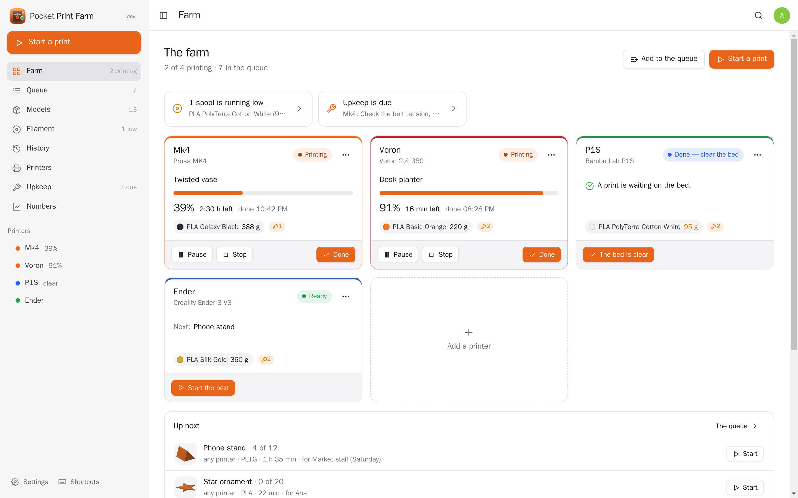
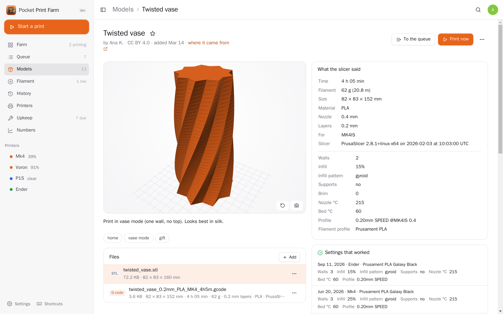
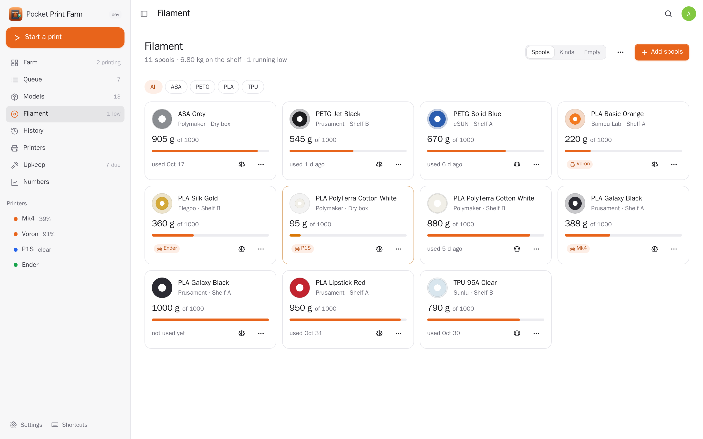
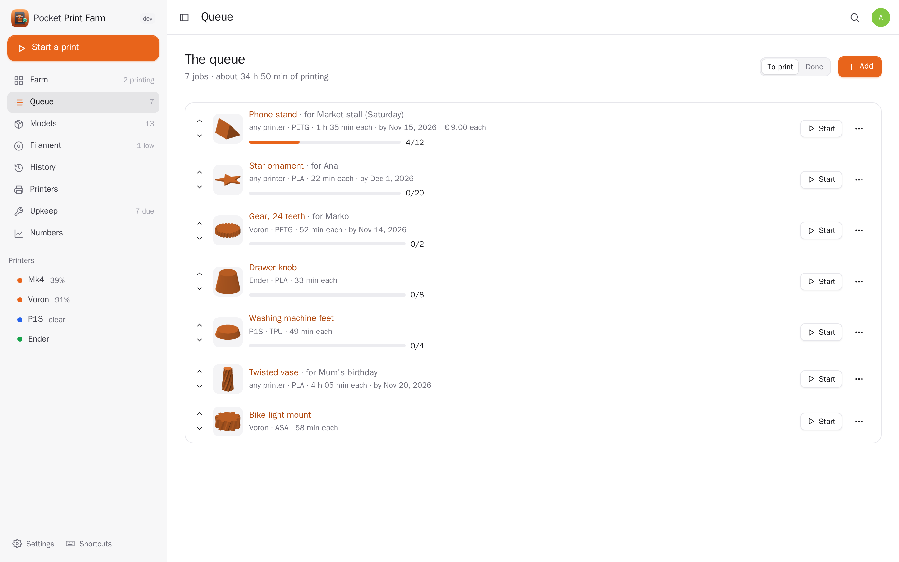
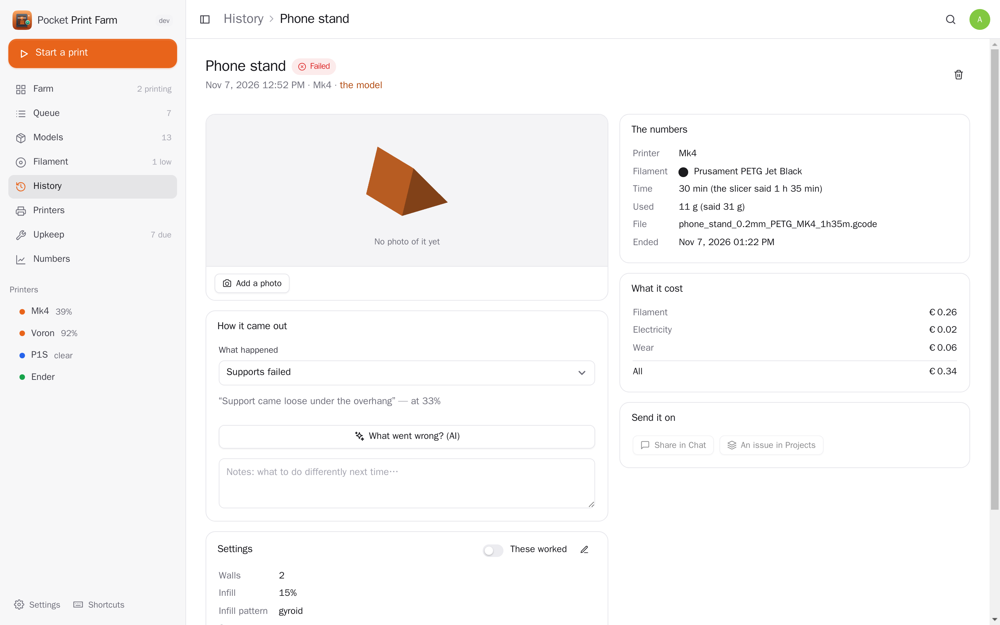
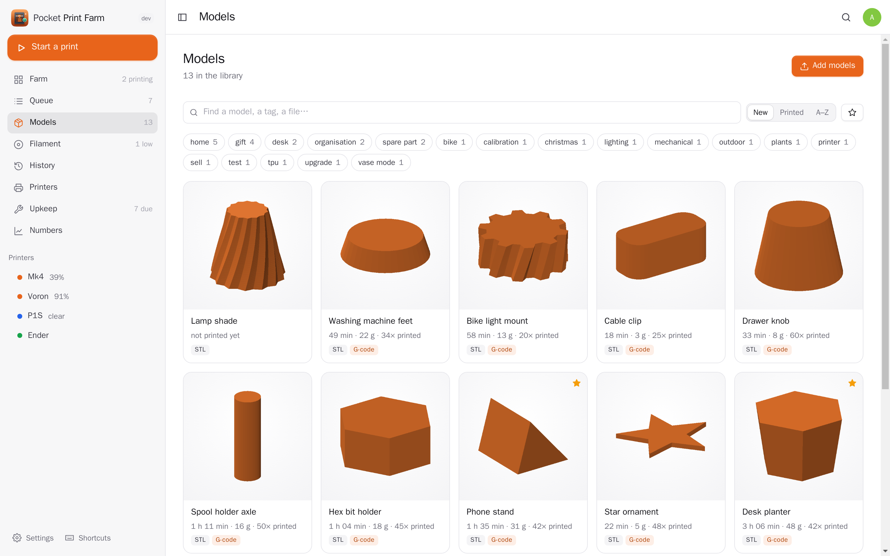
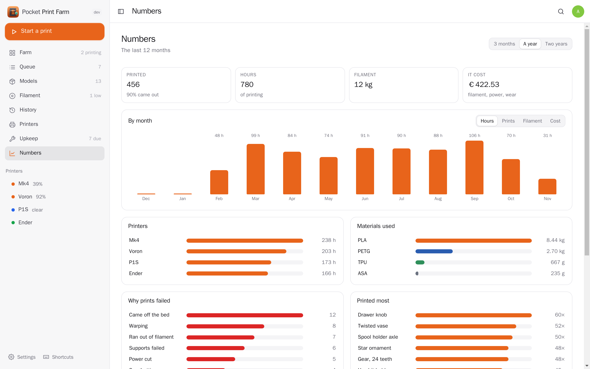
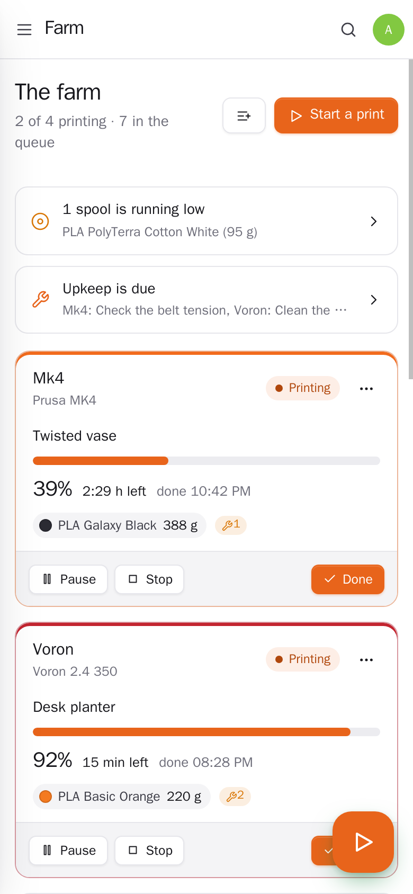
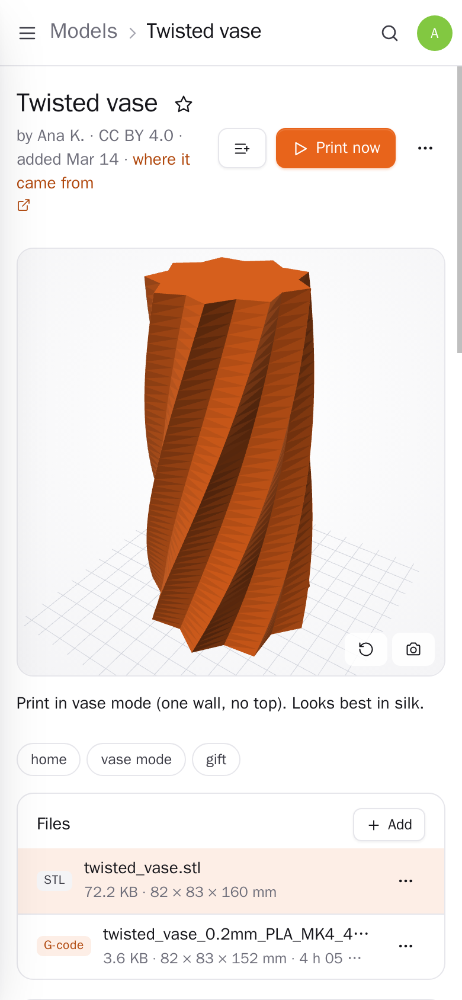
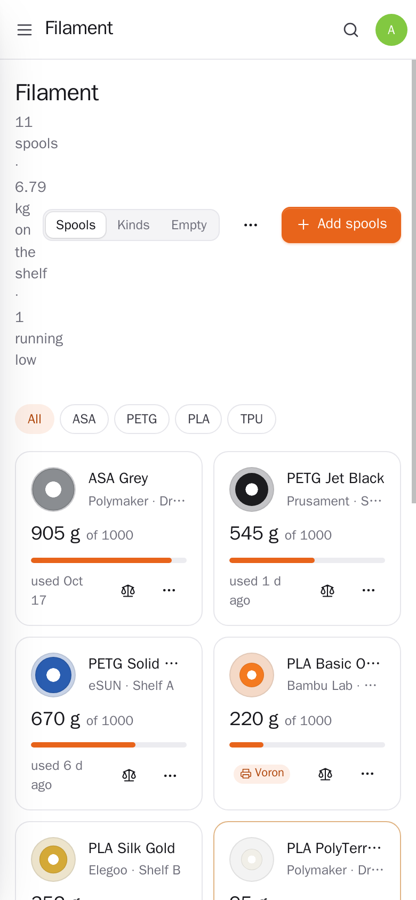

<p align="center"></p>
<h1 align="center">Pocket Print Farm</h1>
<p align="center">Your 3D printers in one place: what each one is printing right now and when it will be done, a queue of what to print next, your models with a 3D view and the slicer’s numbers, your filament spools with what is left on each, every print with how it went and what it cost, and the upkeep each printer needs.<br>One Go binary, one SQLite file, one volume. Part of the Pocket apps; works on its own too.</p>
<p align="center">
  <a href="https://github.com/abjelosevic88/pocket-homelab-print-farm/actions"></a>
  <a href="https://github.com/abjelosevic88/pocket-homelab-print-farm/pkgs/container/pocket-homelab-print-farm"></a>
  <a href="LICENSE"></a>
</p>

---

<p align="center"></p>

<table>
  <tr>
    <td width="50%"></td>
    <td width="50%"></td>
  </tr>
  <tr>
    <td align="center"><sub>A model: turn it in 3D, its files, what the slicer said, the settings that worked.</sub></td>
    <td align="center"><sub>Filament: every spool with what is left, taken off as prints finish.</sub></td>
  </tr>
  <tr>
    <td width="50%"></td>
    <td width="50%"></td>
  </tr>
  <tr>
    <td align="center"><sub>The queue: how many, which colour, for whom, by when — started on a free printer.</sub></td>
    <td align="center"><sub>A print: how it went, why it failed, the settings, and what it cost.</sub></td>
  </tr>
  <tr>
    <td width="50%"></td>
    <td width="50%"></td>
  </tr>
  <tr>
    <td align="center"><sub>The library: STL, 3MF, OBJ, STEP and G-code, with pictures drawn from the shapes.</sub></td>
    <td align="center"><sub>Numbers: hours, filament and costs by month, printers, materials, why prints failed.</sub></td>
  </tr>
</table>

<p align="center">
  &nbsp;&nbsp;
  &nbsp;&nbsp;
  
</p>

## What it does

**Printers, live**
- Connect each printer through **Klipper (Moonraker)**, **OctoPrint** or **PrusaLink** — or keep it **by hand** (you say when a print starts and ends; the time left comes from the slicer).
- Print Farm asks connected printers every few seconds: printing what, how far, time left and the clock time it will be done, layer, nozzle and bed temperatures, and a **camera** picture.
- **Pause, go on, stop** from any phone. Prints started on the printer’s own screen are seen too, and matched to the file in the library.
- After a print: **“the bed is clear”** before the next one starts (or start the next job by itself on printers that clear their own bed).

**The queue**
- What to print next, in order: a model, **how many**, which **filament** or material, which printer (or the first one free), **for whom** (from Pocket Contacts), **by when**, and the price when you sell it.
- Start a job on a free printer: its G-code is **sent to the printer, which starts it**. Each print counts towards the job until all are done.

**Models**
- Upload **STL, 3MF, OBJ, STEP and G-code** — from this device, a link, or Pocket Files. The same file twice is kept once.
- A **3D view** you turn with a finger, with the build plate; a picture drawn from the shape on the server, or the slicer’s own picture.
- From **G-code** (PrusaSlicer, OrcaSlicer, Bambu Studio, SuperSlicer, Cura): time, grams and metres of filament, size, layer height, nozzle, material and the settings people compare (walls, infill, supports, temperatures).
- **Settings that worked**, kept from your own prints, on each model.

**Filament**
- Kinds of filament (brand, material, colour, temperatures, price) and the **spools** on the shelf with **what is left on each**.
- What a print used comes **off the spool in the printer** when it ends (from the slicer’s grams, or the metres the printer counted). **Weigh** a spool on a kitchen scale to set it right.
- Running low? You are told. Bring your spools over from **Spoolman** (its address or its export), again and again.

**Every print**
- How it went: done (with stars), failed — why (came off the bed, spaghetti, warping, clog, layer shift…) and at how far — or stopped. A **photo**, notes, the settings.
- **What it cost**: the filament (from the spool’s price), the electricity (the printer’s watts × your kWh price) and wear (per print hour), with a **price to sell it at**.
- **Pocket AI** says what probably went wrong with a failed print and what to change, and suggests settings to start from for a model — from your own prints.

**Upkeep**
- What each printer needs every so many **print hours** or **days** (clean the nozzle, grease the rails, the belts…), counted from the hours it really printed; a log book of upkeep and repairs.

**And** numbers for the year, search, a JSON export/import and a CSV of every print.

## Works with the other Pocket apps

All optional, each switched on per person (Pocket Core → Links, or directly with a URL and token):

| App | What for |
|---|---|
| Pocket Files | Bring models in; keep copies of model files and photos of prints |
| Pocket Inventory | Put finished prints on the inventory (or add to how many there are) |
| Pocket Money | A spool bought as an expense |
| Pocket Invoicing | A draft invoice for a job you sell |
| Pocket Contacts | Who a job is for |
| Pocket Tasks | A task when upkeep is due (ticked off when it is done); a task for a job |
| Pocket Calendar | When a long print will be done |
| Pocket Chat | Share a finished print with its photo |
| Pocket Parcels | Filament on the way |
| Pocket Projects | An issue from a print (a part for a project, a failure to look into) |
| Pocket Home | The printer as an appliance: upkeep and repairs in its log there |
| Pocket Alerts | A print done or failed, a spool running low, upkeep due, a printer not answering |

Print Farm offers `printfarm:read` and `printfarm:write` to the rest of the box (Pocket Day, Search, AI — “how long until the vase is done?”, “queue two phone stands in black PETG”; a link never starts or stops a printer), and publishes `printfarm.print_started`, `print_finished`, `print_failed`, `job_added`, `job_done`, `spool_low`, `upkeep_due`, `model_added`.

Pocket Search, Pocket Day and Pocket Hub find Print Farm on their own, with nothing to set up in any of them: your models, printers, filament, prints and queued jobs turn up in Search (`!printfarm vase`, `!3d`, `!print3d`), Hub shows a "Printers" widget with what each printer is doing now and what waits in the queue, and the day's prints are offered to the journal (Pocket Day keeps its own, fuller reading through `printfarm:read` for now). These only read; nothing in them starts, pauses or stops a print, and a quick line typed in Hub cannot be kept here, because a job needs a model and a print a printer. The routes are in [docs/api.md](docs/api.md#pocket-search-pocket-day-and-pocket-hub).

## Run it

```sh
docker run -d --name pocket-printfarm -p 8080:8080 -v ./data:/data \
  -e BASE_URL=http://printfarm.local:8080 -e ADMIN_EMAIL=you@example.com -e ADMIN_PASSWORD=change-me \
  ghcr.io/abjelosevic88/pocket-homelab-print-farm:latest
```

Or [docker-compose.yml](docker-compose.yml), or a release binary (`pocket-printfarm`). `make run` starts it with demo data and no login. The server has to reach your printers on the network (their address as you would type it in a browser).

- [Configuration](docs/configuration.md) · [API](docs/api.md) · [Backup](docs/backup.md) · [Reverse proxy](docs/reverse-proxy.md)

## Develop

`make dev` (API on :8080, Vite on :5173), `make test` (go vet, go test, tsc). Go 1.26, React 19, TypeScript, Vite; SQLite through modernc (no CGO). The printer drivers are in `internal/printers`, the file readers (G-code, STL, 3MF, OBJ) and the thumbnail drawer in `internal/slicer`, the WebGL view in `web/src/components/Viewer3D.tsx`. `scripts/screenshots.mjs` is a browser smoke test and makes the screenshots.

MIT © 2026 Aleksandar Bjelosevic
